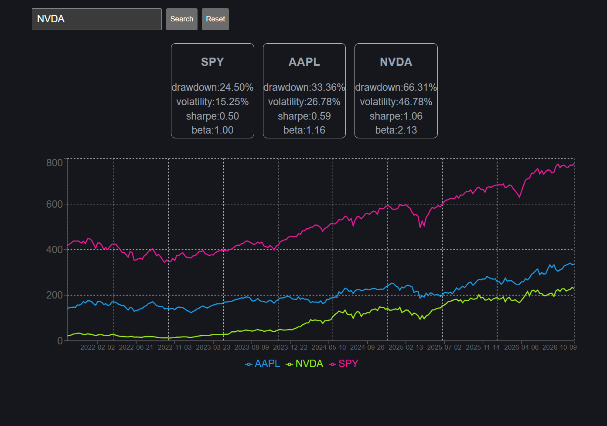

# StockApp

* Full stack stock app. Provides risk analysis (Sharpe ratio, beta, volatility, drawdown) as well as a chart to directly compare stock pricing over past 5 years. 
* Metrics were validated against Portfolio Visualizer

## Live demo links
* note startup may take some time based on render free tier
Frontend: https://stock-app-git-main-nolenheiser1.vercel.app/

## Features
### Single-stock analysis
* Backend calculates sharpe, beta, volatilty and drawdown. (For any allowed tickers)

### Multi-Stock
* Supports up to 5 tickers at once each paired with own single-stock analysis card.
* Each stock appears on a shared chart with its own color and a legend

### Input Validation
* Tickers are validated before they are passed to backend to make sure data can be pulled.
* If a stock is no longer available an error is thrown.
* Duplicate tickers are not allowed.

### Error codes
Distinct messages for: 
* Bad input (400) 
* Rate limiting (429)
* Upstream data provider failures (502)

## Validation

* Reference numbers used are from Portfolio Visualizer using their backtesting tool over a period from October 2021 to August 2026

### Table 1: StockApp (daily returns) vs. Portfolio Visualizer

| Ticker | Metric           |    PV | StockApp (daily) | Abs diff | Rel diff |
|:-------|:-----------------|------:|-----------------:|---------:|---------:|
| SPY    | Beta             |  1.00 |             1.00 |     0.00 |     0.0% |
| SPY    | Sharpe           |  0.60 |             0.52 |     0.08 |    13.3% |
| SPY    | Max drawdown (%) | 23.90 |            24.50 |    -0.60 |     2.5% |
| SPY    | Volatility (%)   | 15.70 |            15.24 |     0.46 |     2.9% |
| AAPL   | Beta             |  1.09 |             1.16 |    -0.07 |     6.4% |
| AAPL   | Sharpe           |  0.61 |             0.59 |     0.02 |     3.3% |
| AAPL   | Max drawdown (%) | 26.40 |            33.36 |    -6.96 |    26.4% |
| AAPL   | Volatility (%)   | 25.00 |            26.78 |    -1.78 |     7.1% |
| NVDA   | Beta             |  2.20 |             2.13 |     0.07 |     3.2% |
| NVDA   | Sharpe           |  1.07 |             1.07 |     0.00 |     0.0% |
| NVDA   | Max drawdown (%) | 62.80 |            66.31 |    -3.51 |     5.6% |
| NVDA   | Volatility (%)   | 50.20 |            46.75 |     3.45 |     6.9% |
| TSLA   | Beta             |  1.76 |             2.05 |    -0.29 |    16.5% |
| TSLA   | Sharpe           |  0.22 |             0.32 |    -0.10 |    45.5% |
| TSLA   | Max drawdown (%) | 67.70 |            73.63 |    -5.93 |     8.8% |
| TSLA   | Volatility (%)   | 59.10 |            57.97 |     1.13 |     1.9% |
| AMZN   | Beta             |  1.49 |             1.50 |    -0.01 |     0.7% |
| AMZN   | Sharpe           |  0.32 |             0.29 |     0.03 |     9.4% |
| AMZN   | Max drawdown (%) | 52.10 |            55.73 |    -3.63 |     7.0% |
| AMZN   | Volatility (%)   | 34.50 |            32.80 |     1.70 |     4.9% |
| PLTR   | Beta             |  1.64 |             2.08 |    -0.44 |    26.8% |
| PLTR   | Sharpe           |  0.81 |             0.89 |    -0.08 |     9.9% |
| PLTR   | Max drawdown (%) | 75.20 |            77.57 |    -2.37 |     3.2% |
| PLTR   | Volatility (%)   | 77.70 |            64.82 |    12.88 |    16.6% |
| GOOGL  | Beta             |  1.20 |             1.25 |    -0.05 |     4.2% |
| GOOGL  | Sharpe           |  0.58 |             0.58 |     0.00 |     0.0% |
| GOOGL  | Max drawdown (%) | 40.40 |            44.32 |    -3.92 |     9.7% |
| GOOGL  | Volatility (%)   | 31.60 |            30.55 |     1.05 |     3.3% |

### Table 2: StockApp (month-end recompute) vs. Portfolio Visualizer

| Ticker | Metric           |    PV | StockApp (month-end) | Rel diff |
|:-------|:-----------------|------:|---------------------:|---------:|
| SPY    | Beta             |  1.00 |                 1.00 |     0.0% |
| SPY    | Max drawdown (%) | 23.90 |                23.90 |     0.0% |
| SPY    | Volatility (%)   | 15.70 |                15.70 |     0.0% |
| AAPL   | Beta             |  1.09 |                 1.09 |     0.0% |
| AAPL   | Max drawdown (%) | 26.40 |                26.40 |     0.0% |
| AAPL   | Volatility (%)   | 25.00 |                25.00 |     0.0% |
| NVDA   | Beta             |  2.20 |                 2.27 |     3.2% |
| NVDA   | Max drawdown (%) | 62.80 |                62.80 |     0.0% |
| NVDA   | Volatility (%)   | 50.20 |                50.20 |     0.0% |
| TSLA   | Beta             |  1.76 |                 1.73 |     1.7% |
| TSLA   | Max drawdown (%) | 67.70 |                67.70 |     0.0% |
| TSLA   | Volatility (%)   | 59.10 |                59.10 |     0.0% |
| AMZN   | Beta             |  1.49 |                 1.50 |     0.7% |
| AMZN   | Max drawdown (%) | 52.10 |                52.10 |     0.0% |
| AMZN   | Volatility (%)   | 34.50 |                34.50 |     0.0% |
| PLTR   | Beta             |  1.64 |                 1.60 |     2.4% |
| PLTR   | Max drawdown (%) | 75.20 |                75.20 |     0.0% |
| PLTR   | Volatility (%)   | 77.70 |                77.70 |     0.0% |
| GOOGL  | Beta             |  1.20 |                 1.22 |     1.7% |
| GOOGL  | Max drawdown (%) | 40.40 |                40.40 |     0.0% |
| GOOGL  | Volatility (%)   | 31.60 |                31.60 |     0.0% |

* Stock App uses daily returns to calculate the values, however Portfolio Visualizer calculates over monthly values. Due to this I used a second test to calculate difference over monthly values. This produced values within 3.2%.

* Sharpe was left out of the monthly test because I would have needed the monthly Risk-Free rate used by Portfolio Visualizer to fully validate the numbers. In this case I felt the daily test did a good enough job and opted to focus on the other 3 metrics. 

* Table 2 comes from a separate test script not from the deployed app. This separate test script does use analysis tools found in analysis.py.

* Validation ran over the full 5-year window. The deployed app’s volatility metric defaults to 3 years.

## Tech-stack
### Backend
* Python, FastAPI
* slowapi — rate limiting
* FMP — historical price data
* Finnhub — real-time price data (Currently only exists in backend, not used further)
* FRED — 10-year Treasury rate (used for Sharpe calculation)
* In-memory cache
* Deployed on Render

### Frontend
* React, TypeScript, Vite
* TanStack Query
* Recharts
* Deployed on Vercel

## Methodology (for risk analysis)
* Volatility: Standard deviation of simple returns over a 3 year window.
* Sharpe ratio: mean daily excess return (daily risk free rate is pulled from FRED) divided by the standard deviation of excess returns. This is calculated over the entire 5 year window that fmp provides.
* Beta: covariance of a stocks returns compared to SPY(market that follows the S&P 500), stock must have at least 252 data points to qualify for beta calculation. This metric uses log returns
* Drawdown: maximum peak-to-trough decline over the full 5-year window.
* Data window: Maximum length of data return is 5 years (per FMP)
* Tickers allowed: FMP only allows certain tickers to be requested on its free tier. Therefore the scope of the project is currently limited to those tickers

## Prerequisites 

Python 3.10+
Node.js 18.0+ 
npm

## License

Distributed under the MIT License. See `LICENSE` for details.